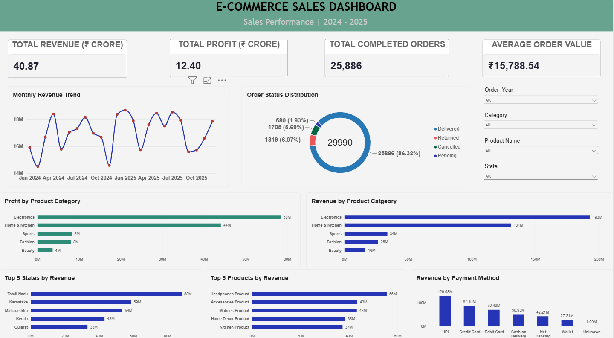

# E-commerce Sales Analysis

An end-to-end data analytics project analyzing e-commerce sales performance using **Microsoft Excel, SQL, Python, and Power BI**.

## Project Overview

This project analyzes e-commerce order data to understand sales performance, profitability, customer purchasing behavior, product performance, and order status. It transforms raw data into meaningful business insights through data cleaning, exploratory data analysis, SQL queries, and an interactive Power BI dashboard.



## Business Objectives

- Analyze revenue and profit performance.
- Identify top-performing product categories and products.
- Understand monthly and yearly sales trends.
- Analyze order status and payment methods.
- Identify high-performing states.
- Examine customer purchasing patterns and repeat customers.
- Build an interactive dashboard to support data-driven decisions.

## Tools and Technologies

| Tool | Purpose |
|---|---|
| Microsoft Excel | Data cleaning, formulas, PivotTables, and analysis |
| SQL / MySQL | Data querying, aggregation, and business analysis |
| Python | Data cleaning, exploratory data analysis, and customer analysis |
| Pandas, NumPy, Matplotlib | Data manipulation and visualization |
| Power BI | Interactive dashboard and KPI reporting |

## Project Workflow

1. **Data Cleaning:** Prepared the data, handled missing values, and created calculated fields.
2. **Excel Analysis:** Used formulas and PivotTables to analyze sales, profits, products, and customers.
3. **SQL Analysis:** Queried the data to calculate business metrics and identify trends.
4. **Python EDA:** Explored sales distributions, customer behavior, and purchasing patterns.
5. **Power BI Dashboard:** Developed interactive visuals, KPI cards, and slicers for business reporting.

## Key Business Insights

The following figures represent the overall dataset results with dashboard filters cleared.

| KPI | Result |
|---|---:|
| Total Completed Revenue | ₹40.87 Crore |
| Total Completed Profit | ₹12.40 Crore |
| Completed Orders | 25,886 |
| Average Order Value | ₹15,788.54 |
| Total Order Records Analyzed | 29,990 |

### Additional Findings

- **Leading category:** Electronics generated approximately ₹19.30 crore in revenue and ₹5.84 crore in profit.
- **Second-highest category:** Home & Kitchen generated approximately ₹13.09 crore in revenue and ₹4.40 crore in profit.
- **Order fulfillment:** Approximately 86.32% of order records had a Delivered status.
- **Customer behavior:** The analysis examined one-time and repeat customers to understand repeat purchasing patterns.
- **Yearly performance:** Revenue increased from approximately ₹20.05 crore in 2024 to ₹20.82 crore in 2025.

*Note: These figures are based on the project's current cleaned dataset and business calculation rules.*

## Power BI Dashboard

The interactive dashboard includes:

- Revenue and profit KPI cards
- Monthly revenue trend
- Revenue and profit by category
- Order status distribution
- Top five products
- Top five states
- Revenue by payment method
- Year and category slicers

## Project Structure

```
Ecommerce-Sales-Analysis/
│
├── Excel/
│   └── Excel analysis files
│
├── SQL scripts and queries
│
├── Python exploratory analysis files
│
├── PowerBI/
│   └── Power BI dashboard (.pbix)
│   └── screenshots Dashboard screenshots
│
└── README.md
```

## Skills Demonstrated

- Data cleaning and preprocessing
- Excel formulas and PivotTables
- SQL queries and aggregations
- Python exploratory data analysis
- KPI development and business reporting
- Data visualization and dashboard design
- Translating data into actionable business insights

## Conclusion

This project demonstrates an end-to-end data analytics workflow, from preparing raw data to building an interactive dashboard. It showcases practical skills in Excel, SQL, Python, and Power BI for analyzing business performance and communicating insights.

## Author

**Vishwa Kumar S**

Aspiring Data Analyst

[LinkedIn](https://www.linkedin.com/in/vishwa-kumar-s-a8674a29b) | [GitHub](https://github.com/vishwa-kumar-s)
